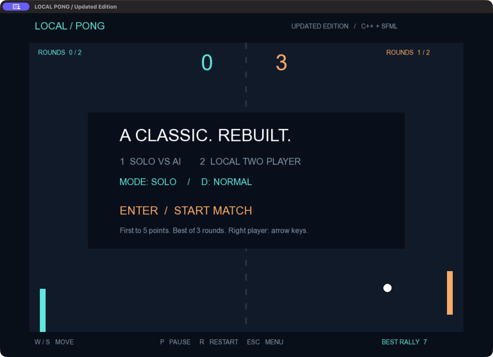

# Local Pong — Updated Edition

A C++17 / SFML 3 game evolved from a two-player hackathon prototype. Play solo against three AI difficulties or challenge someone on the same keyboard.



## What changed

| Original (preserved) | Updated edition |
| --- | --- |
| Two players only | Solo AI plus two-player mode |
| Close the window to restart | Menu, pause, restart and rematch |
| 60 Hz simulation in the main file | 120 Hz simulation independent of SFML |
| Discrete overlap collisions | Swept paddle-face crossings and impact-angle rebounds |
| Per-axis velocity cap | Total ball speed capped at 780 units/second |
| Basic score display | Match statistics, ball trail and aspect-preserving layout |
| No test target | 14 automated checks through CTest |

## Build and play

Requires CMake 3.24+, C++17 and SFML 3. Tested on macOS with SFML 3.0.2.

```sh
brew install cmake sfml
cmake -S . -B build -DCMAKE_BUILD_TYPE=Release
cmake --build build
ctest --test-dir build --output-on-failure
./build/pong
```

On the menu: **1** selects solo, **2** selects two-player, **D** cycles AI difficulty, **Enter** starts. **W/S** moves the left paddle; **Up/Down** moves the right paddle. **P** pauses/resumes, **R** restarts, **Esc** returns to the menu. Losing window focus automatically pauses. First to five points wins a round; first to two rounds wins the match.

A font is required. The game checks `assets/fonts/DejaVuSans.ttf`, then system Arial on macOS/Windows and DejaVu Sans on Linux. No font is redistributed. Supply a legally usable font at the asset path if your system has none of these. Windows/Linux GUI builds have not been verified.

## Preserved original

`main.cpp` and `game_types.hpp` are unchanged. The updated source is beside them as `main_updated.cpp` and `game_updated.hpp`. `ORIGINAL_SHA256.txt` records the original checksums (verify from the parent directory). Build the original separately:

```sh
cmake --build build --target pong_original
./build/pong_original
```

## Architecture and tradeoffs

- **Simulation:** `game_updated.hpp` has no SFML dependency. A caller supplies elapsed simulation time and normalized paddle input. The application calls it at 120 Hz and caps catch-up time after stalls.
- **States:** Menu, Serve, Playing, Paused and MatchOver make transitions explicit. Pausing remembers whether the ball was waiting to serve or already moving.
- **Physics:** A segment crossing a paddle face calculates impact time within the step. The remaining fraction advances the reflected ball. Hit location controls rebound angle; speed increases by 35 to a total cap of 780. The collision model approximates rounded paddle corners with an expanded vertical interval, rather than solving exact circle/corner contact.
- **AI:** Reaction delay, bounded movement speed and aim error create three difficulty levels. It uses current ball position, not perfect future trajectory prediction. A fixed random seed makes same-input runs repeatable on the same standard-library implementation.
- **Rendering:** SFML owns the window, drawing and input. Letterboxing preserves court proportions when resized. Trails are cosmetic and do not affect simulation.

## Verification

`game_tests_updated.cpp` checks paddle bounds, serve transition, pause/resume, high-speed paddle crossing, impact direction and speed cap, wall bounce, 2–0 and 2–1 matches, restart, paused serve, goal reset, repeatability and AI bounds. Checks remain enabled in Release builds. Run without SFML or a display:

```sh
cmake -S . -B build-tests -DPONG_BUILD_GAME=OFF
cmake --build build-tests
ctest --test-dir build-tests --output-on-failure
```

The macOS game was launched and its menu, moving paddles, AI scoring and pause overlay were checked. Automated checks are focused regression coverage, not exhaustive proof. Online play, audio, controller support, saved statistics and portable installers are future work.

## Development note

The original hackathon source is retained for comparison. The updated edition was developed with AI assistance. See [INTERVIEW_GUIDE.md](INTERVIEW_GUIDE.md) for the design questions and code paths worth understanding before presenting this project.
